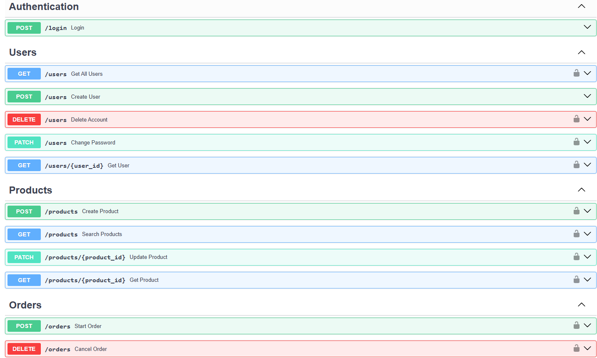
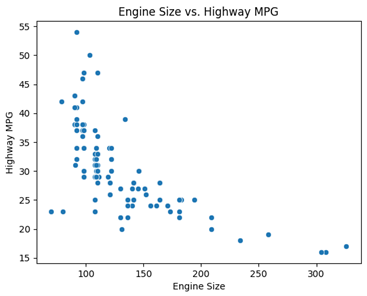

# Hi, I'm Christiaan Cronje

### Junior Backend Developer | Python | FastAPI | PostgreSQL

I've developed Python applications for real businesses, including tools that automate sales analysis, inventory management, and purchasing recommendations. I've also integrated applications with Shopify's APIs and built a REST API with authentication, role-based access control, and a PostgreSQL database.

My main focus is backend development, particularly building APIs, working with relational databases, and turning business requirements into working software. I'm continuing to expand my skills through practical projects.

## Technologies

  

- **Languages:** Python, SQL
- **Backend:** FastAPI, REST APIs, SQLAlchemy, Pydantic
- **Databases:** PostgreSQL, SQLite
- **Authentication:** JWT, OAuth2, role-based authorization
- **Tools:** Docker, Docker Compose, Alembic, pytest, Git, GitHub
- **Data Analysis:** Pandas, NumPy, Matplotlib, Seaborn, Tableau

## Featured Projects

### Inventory API

RESTful inventory and order management API built with FastAPI and PostgreSQL.

**Technologies:** Python, FastAPI, PostgreSQL, SQLAlchemy, Pydantic, Alembic,
Docker, pytest

[View Project](https://github.com/ChristiaanCronje/inventory-api)

### Data Analytics Portfolio

A collection of Python and SQL projects covering data cleaning, exploratory
data analysis, visualisation and working with structured datasets.

**Technologies:** Python, SQL, Pandas, NumPy, Matplotlib, Seaborn, Tableau, SQLite

[View Project](https://github.com/ChristiaanCronje/data-analytics-portfolio)

## Contact

  
  

<!--
**ChristiaanCronje/ChristiaanCronje** is a ✨ _special_ ✨ repository because its `README.md` (this file) appears on your GitHub profile.

Here are some ideas to get you started:

- 🔭 I’m currently working on ...
- 🌱 I’m currently learning ...
- 👯 I’m looking to collaborate on ...
- 🤔 I’m looking for help with ...
- 💬 Ask me about ...
- 📫 How to reach me: ...
- 😄 Pronouns: ...
- ⚡ Fun fact: ...
-->
